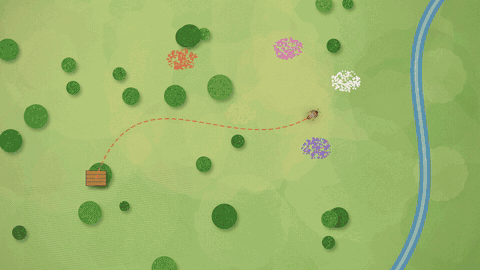
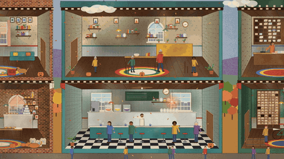
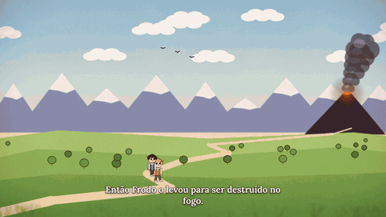
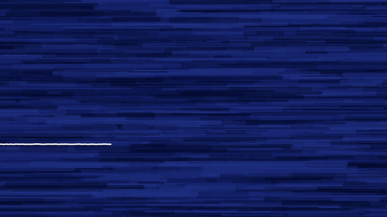
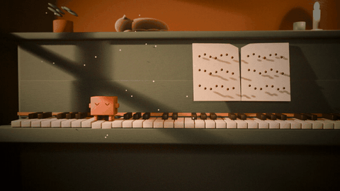
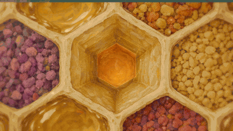
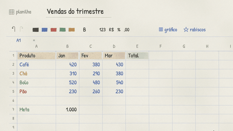
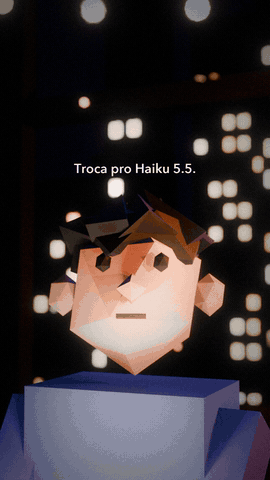
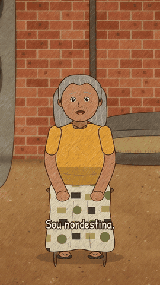

<p align="center">
  
</p>

<h1 align="center">Motion Code</h1>

<p align="center">
  Vídeos animados feitos 100% em código, com voz por IA.<br>
  Sem editor de vídeo, sem banco de imagens: a história é o produto, o motor só executa o roteiro.
</p>

---

## Vitrine

Um trecho de cada estilo, tirado de episódios que já saíram daqui.

| Prancha Viva | Vila Acesa |
|:---:|:---:|
|  |  |
| ciclo educativo ilustrado, narrador de documentário | cidade em corte de livro ilustrado |
| **Fantasia** | **Rabisco** |
|  |  |
| lenda em ilustração vetorial com névoa e paralaxe | caneta e giz de cera que se desenham na tela |
| **Lofi** | **Higgsfield** |
|  |  |
| cena 3D aconchegante em loop, trilha lofi em código | ativos da Higgsfield animados em código |
| **Excel Desenhado** | **Contos com Claude** · **Histórias Reais** |
|  |   |
| planilha desenhada à mão como palco de motion graphics | diálogo cômico em low-poly 3D · depoimentos em desenho infantil |

Os GIFs são mudos. Os vídeos de verdade têm narração, trilha e efeitos, tudo gerado pelo próprio projeto.

## Como funciona

Você conversa com o [Claude Code](https://claude.com/claude-code) dentro desta pasta. Ele lê o `CLAUDE.md` da raiz (o estúdio) e o `CLAUDE.md` do estilo escolhido, escreve o roteiro, gera a voz, desenha quadro a quadro e entrega o MP4.

```
você: "quero um vídeo de 1 minuto no estilo Fantasia sobre a lenda do Saci, em 9:16"
  → roteiro.json  → narração (Fish Audio)  → desenho em Canvas/Blender  → trilha em código  → mp4
```

## Começar

Precisa de macOS (os scripts usam zsh e o Chrome em `/Applications`). Só quer **editar um vídeo que você gravou**? Pule para o [Studio](#studio-edite-o-seu-vídeo): sem chave, também no Windows.

### Jeito fácil: o seu Claude instala tudo

Abra uma sessão do Claude Code e cole:

```text
Instala o repositório https://github.com/mackswendhell/motion-code na pasta ~/dev, seguindo a seção "Instalação (instruções para o agente)" do README.
```

Ele instala os programas e as skills. Só a chave da voz fica com você, no fim.

### Instalação (instruções para o agente)

Se você é um agente de IA instalando este repositório, faça nesta ordem, pulando o que já estiver instalado, e diga no fim o que falhou:

1. Clone na pasta indicada, fora de OneDrive, iCloud ou Dropbox: `git clone https://github.com/mackswendhell/motion-code.git`.
2. Programas: `brew install python ffmpeg node yt-dlp git` e `brew install --cask blender google-chrome`. Sem Homebrew, passe à pessoa o comando de [brew.sh](https://brew.sh) para ela rodar no terminal dela, porque ele pede a senha do Mac.
3. Bibliotecas de Python: `python3 -m pip install numpy pillow`. Se der `externally-managed-environment`, repita com `--break-system-packages`.
4. Motor 2D: `cd nucleo/2d && npm install`.
5. Studio e skills: `cd estilos/studio && npm run instalar`. Isso instala o Remotion, a transcrição local e as skills **`watch`** e **`remotion-best-practices`**.
6. Chave: nunca peça a chave no chat. Diga à pessoa para gerar em [fish.audio/app/developers](https://fish.audio/app/developers) ou [openrouter.ai/keys](https://openrouter.ai/keys) e rodar `./configurar.sh` no terminal dela. Só os estilos com voz precisam da chave; o Studio não.
7. Termine dizendo à pessoa para **abrir uma sessão nova** do Claude dentro da pasta (`estilos/studio`, se for editar um vídeo gravado). Skills instaladas só aparecem numa sessão nova.

### Jeito manual

**1. Baixar**

```sh
git clone https://github.com/mackswendhell/motion-code.git
cd motion-code
```

**2. Pôr a sua chave e instalar o motor**

```sh
./configurar.sh
```

Ele pede a chave da API do [Fish Audio](https://fish.audio/app/developers) ou do [OpenRouter](https://openrouter.ai/keys), você cola e dá Enter. A chave não aparece na tela e vai direto para `.env`, que nunca sobe para o git. O script também confere o que falta instalar.

Prefere sem script? Uma linha faz o mesmo (com o OpenRouter, troque o nome para `OPENROUTER_API_KEY`):

```sh
read -rs "k?Chave do Fish Audio: " && echo "FISH_API_KEY=$k" > .env && chmod 600 .env
```

Com a chave do Fish, o modelo padrão é o `s2.1-pro-free`, gratuito na API dele (uso justo, por tempo limitado); para outro, ponha `FISH_MODEL=s2.1-pro` (ou `drama-3`) no `.env`. Pelo OpenRouter, a voz custa centavos por minuto e vale pôr um limite de crédito na chave.

**3. Abrir no Claude Code e pedir**

```sh
claude
```

Diga o que quer. Se não disser o estilo e o formato (9:16, 1:1 ou 16:9), ele pergunta.

### Requisitos

| | Para quê |
|---|---|
| Python 3 + `numpy` + `pillow` | voz, trilhas, montagem |
| `ffmpeg` | áudio e vídeo |
| Node 24 + Google Chrome | estilos 2D (Canvas capturado quadro a quadro) |
| Blender 5 | só Contos com Claude e Lofi |
| conta na Higgsfield | só o estilo Higgsfield |

```sh
brew install python ffmpeg node yt-dlp
brew install --cask blender google-chrome
python3 -m pip install numpy pillow || python3 -m pip install --break-system-packages numpy pillow
```

## Vozes

Todas as vozes vêm do [Fish Audio](https://fish.audio), direto pela API (modelo `s2.1-pro-free`) ou pelo OpenRouter (modelo `fish-audio/drama-3`). O elenco fica em [`nucleo/vozes.json`](nucleo/vozes.json). Cada voz é de um destes dois tipos:

- **Da biblioteca do Fish**: `"voz": "<id>"`. Funciona direto. Ache vozes em [fish.audio](https://fish.audio) e copie o id da página da voz.
- **Clone**: `"clone": "referencias/<nome>.wav"` e `"clone_texto": "referencias/<nome>.txt"` (a transcrição exata da amostra). As amostras de clone **não vêm no repositório**: elas permitem clonar a voz de alguém. Clone só a sua voz, ou a de quem autorizou.

Os personagens `claude` (Contos com Claude) e `macks` (Narração) usam clone. Para usá-los, ou ponha a sua própria amostra (uns 15 a 30 s de fala limpa, mais o texto) em `nucleo/referencias/`, ou troque o par `clone`/`clone_texto` por um `"voz"` da biblioteca.

## Estilos

| Estilo | O que é | Formatos | Motor |
|---|---|---|---|
| [Contos com Claude](estilos/contos-com-claude/) | diálogo cômico usuário × Claude, low-poly 3D | 9:16 | Blender |
| [Prancha Viva](estilos/prancha-viva/) | ciclo educativo ilustrado, narrador de documentário | 16:9, 1:1, 9:16 | Canvas 2D |
| [Vila Acesa](estilos/vila-acesa/) | cidade em corte, ajudante luminoso em cada cômodo | 16:9, 1:1, 9:16 | Canvas 2D |
| [Rabisco](estilos/rabisco/) | caneta e giz de cera, narrador em primeira pessoa | 9:16, 1:1, 16:9 | Canvas 2D |
| [Fantasia](estilos/fantasia/) | lenda em vetor chapado, névoa, paralaxe | 9:16, 1:1, 16:9 | Canvas 2D |
| [Recorte](estilos/recorte/) | papel recortado nas cores do Claude, por cima de uma narração pronta | 16:9 | Canvas 2D |
| [Aula](estilos/aula/) | abertura de aula sem rosto, tipografia cinética e voz clonada | 16:9 | Canvas 2D |
| [Excel Desenhado](estilos/excel-desenhado/) | planilha desenhada à mão, cursor que clica e digita | 16:9 | Canvas 2D |
| [Higgsfield](estilos/higgsfield/) | pinturas da Higgsfield animadas em código | 16:9 | Canvas 2D / Blender |
| [Histórias Reais](estilos/historias-reais/) | depoimento real recontado em desenho infantil | o do vídeo de origem | Canvas 2D |
| [Lofi](estilos/lofi/) | cena 3D em loop, sem fala, trilha lofi | 16:9 | Blender |
| [Narração](estilos/narracao/) | narração em voz clonada, só áudio | — | Python |
| [Editor 3D](estilos/editor-3d/) | em preparação | 16:9 | — |
| [Studio](estilos/studio/) | edita o vídeo que você gravou, conversando com o Claude | 16:9, 9:16, 1:1 | Remotion |

Cada pasta tem o seu `CLAUDE.md` com tudo o que é dele: referência, direção de cena, estrutura do roteiro, voz, música. Os roteiros dos episódios já feitos ficam em `estilos/<estilo>/episodios/`, bons para estudar.

Rodar um episódio à mão (o Claude Code faz isso por você):

```sh
cd estilos/vila-acesa
./fazer.sh episodios/001-um-dia-na-vila             # tudo, entrega em prontos/
./fazer.sh episodios/001-um-dia-na-vila --ate 2     # só os 2 primeiros atos, para testar
./fazer.sh episodios/001-um-dia-na-vila --formato 9:16
```

## Studio: edite o seu vídeo

O único estilo que não cria do zero: você grava, e o Claude vira o seu diretor de vídeo. Ele assiste, transcreve com o tempo de cada palavra, propõe um plano e, depois que você aprova, anima por cima: textos, prints com zoom e marca-texto, tela dividida, gráficos e legendas. Não precisa saber editar nem programar, e não precisa de chave.

**A instalação traz junto as duas skills de que ele depende**, [`watch`](https://github.com/bradautomates/claude-video) (assiste o vídeo) e [`remotion-best-practices`](https://github.com/remotion-dev/skills) (programa a edição):

```sh
git clone https://github.com/mackswendhell/motion-code.git
cd motion-code/estilos/studio
npm run instalar
```

Depois abra uma sessão **nova** do Claude Code dentro de `estilos/studio` (skills novas só aparecem numa sessão nova), ponha o vídeo em `projetos/001. meu-video/video/` e diga o que quer. O passo a passo está em [primeiros passos](estilos/studio/guias/1-primeiros-passos.md).

O [Remotion](https://www.remotion.dev) é gratuito para pessoas físicas e empresas de até 3 pessoas; empresas maiores precisam de [licença](https://www.remotion.dev/license). O Nível 2 (B-rolls gerados por IA) usa créditos da sua conta [Higgsfield](https://higgsfield.ai) e é opcional.

## Criar um estilo novo

O jeito mais fácil é pedir: *"quero criar um estilo novo, a referência é este vídeo"*. O Claude Code segue o passo a passo do [`CLAUDE.md`](CLAUDE.md#estilo-novo-passo-a-passo). Por baixo:

1. **Pasta e instruções.** Crie `estilos/<nome>/CLAUDE.md`: o que é, a referência analisada, formatos aceitos, voz, música, direção de cena e a estrutura do `roteiro.json`.
2. **Motor.** Se for 2D, parta do núcleo: `motor/pagina.html` carrega `../../../nucleo/2d/base.js` (papel, traço, aquarela, grão) e o seu `cena.js`. O contrato é pequeno: `iniciar(tempo)` e `quadro(t)` desenhando no canvas `#c`. Copie o `fazer.sh` da Vila Acesa (trilha em loop) ou do Rabisco (som que segue o desenho) e troque nome, música e volume. Se for 3D ou outro motor, ele mora dentro da pasta do estilo.
3. **Voz.** Ouça algumas vozes do Fish, escolha de ouvido e registre em `nucleo/vozes.json`. O roteiro diz qual usar (`"voz": "narradora"`).
4. **Amostra antes do vídeo.** Faça um trecho curto (`--ate 1`), aprove o visual e a voz, e só então o episódio inteiro, nos formatos que o estilo aceita.
5. **Registrar.** Ponha o estilo na tabela do `CLAUDE.md` da raiz. As entregas vão para `prontos/<nome>/<NNN-slug>/`.

Regra de ouro: o que só um estilo usa fica na pasta dele; o que dois ou mais usam sobe para `nucleo/`. Nunca copie o núcleo para dentro de um estilo.

## Estrutura

```
motion-code/
  CLAUDE.md        o estúdio: regras comuns, tabela de estilos, como tudo se organiza
  configurar.sh    primeira vez: chave + dependências
  nucleo/          o que mais de um estilo usa
    voz.py         chamada ao Fish pelo OpenRouter
    vozes.json     o elenco
    trilha.py      música de fundo gerada em código
    lofi.py        faixas lofi em loop exato
    2d/            motor 2D comum: base.js, capturar.mjs, narrar.py, painel Motion
  estilos/<nome>/  um estilo completo: CLAUDE.md, motor, fazer.sh, episodios/
  prontos/         as entregas (fora do git)
```

## Painel Motion

Um player com linha do tempo e ajustes ao vivo (grão, traço, zoom, volume da voz e da trilha) para os estilos 2D:

```sh
node nucleo/2d/estudio/servidor.mjs
# abra http://localhost:4317/?ep=vila-acesa/001-um-dia-na-vila
```

Os ajustes ficam em `episodios/<slug>/tweaks.json` e entram no próximo `fazer.sh`.

## O que não está aqui

Para manter o repositório leve e seguro, ficam fora do git: a chave (`.env`), as amostras de clone de voz, os vídeos de referência de terceiros, as entregas (`prontos/`) e toda mídia gerada (quadros, áudio, mp4). Tudo isso o código refaz a partir dos roteiros.
