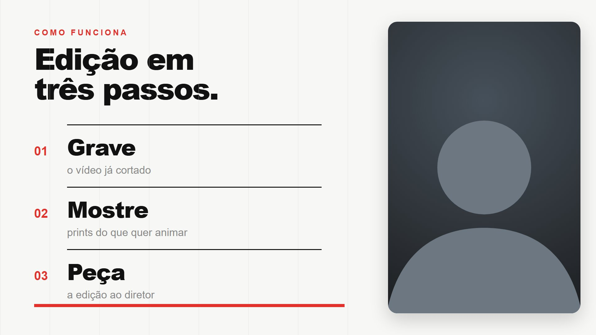
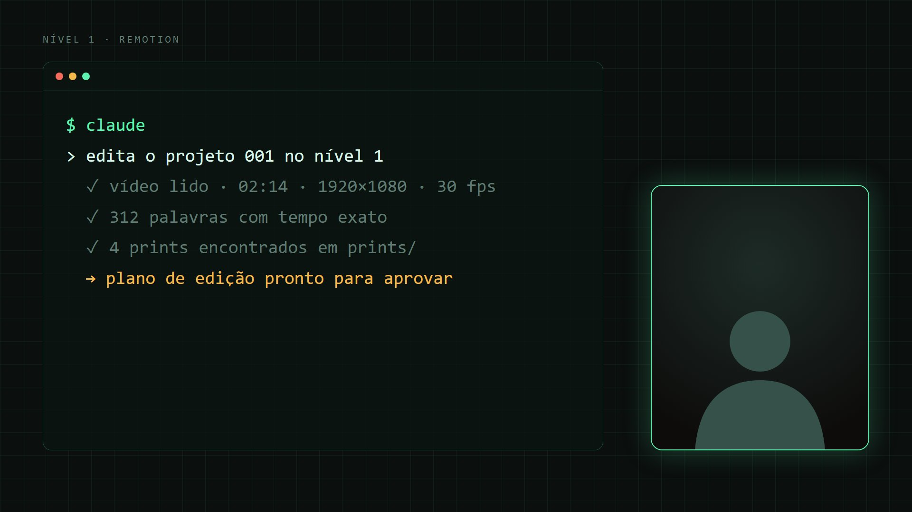
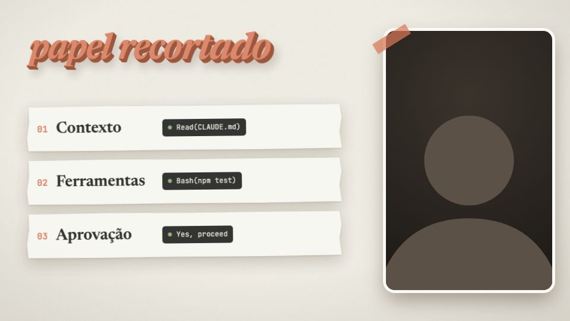
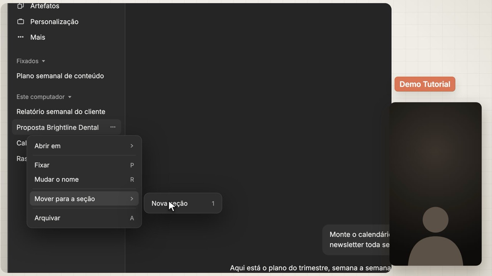
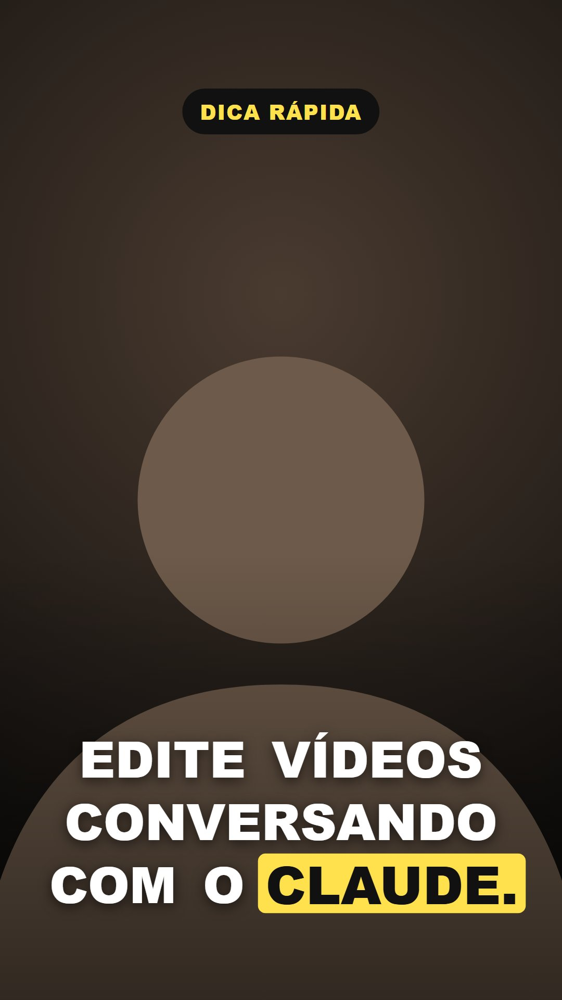
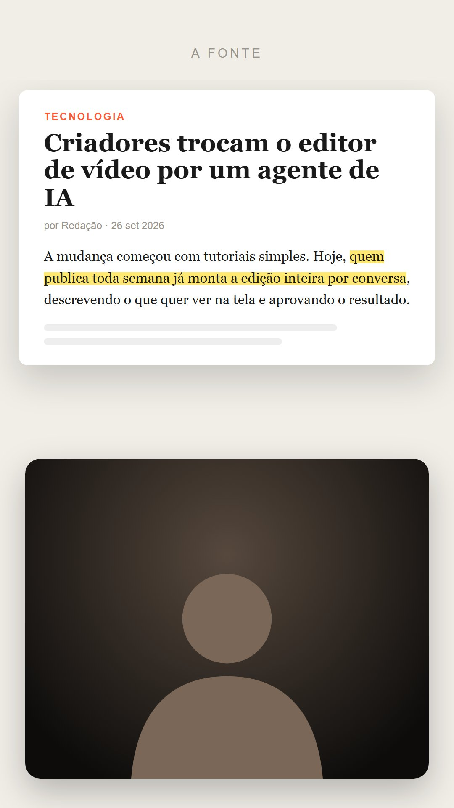
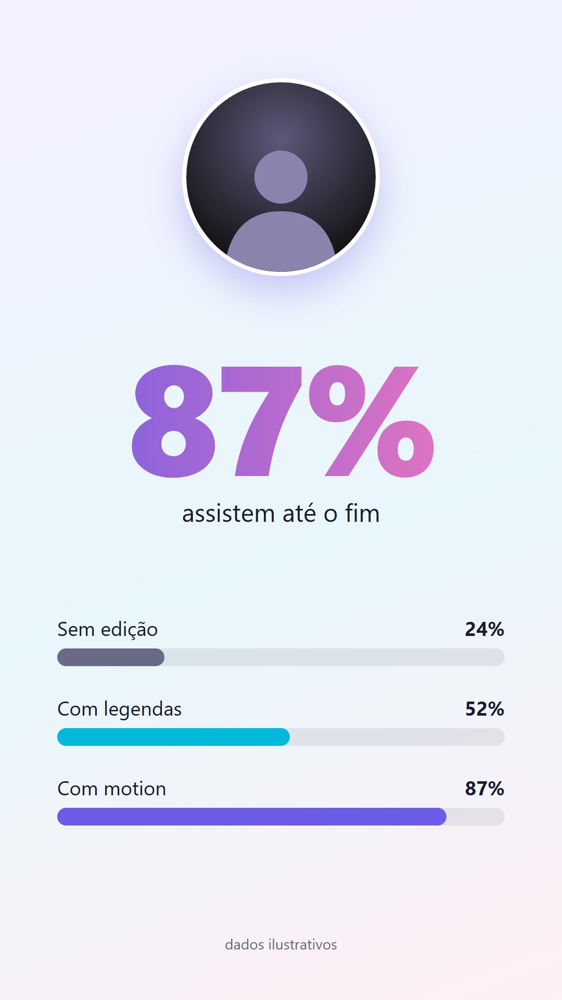

# Galeria de estilos

Referências para você escolher (ou misturar) antes de editar. **Nenhum estilo é obrigatório.** Diga ao Claude qual te agrada, peça variações ("o minimal suíço, mas com fundo escuro") ou traga as suas próprias referências: salve prints de vídeos, sites ou marcas que você admira em `prints/` e peça "segue o estilo destas imagens".

Na conversa, basta citar o nome do estilo em negrito.

---

## Exemplos que rodam no seu computador

Estes sete vêm com código em [src/estilos/](../src/estilos/). Abra `npm run studio` para vê-los em movimento. A silhueta cinza marca onde entra a **sua câmera**.

### Horizontal (16:9)

| | |
|---|---|
|  |  |
| **Minimal suíço.** Fundo branco, tipografia pesada, grade e um único vermelho. Tela dividida com a câmera à direita, entrando junto com o painel. Bom para aulas e passo a passo. | **Terminal técnico.** Fundo escuro com grade fina, fonte mono, texto digitado em tempo real, câmera em card com brilho. Bom para programação, IA e ferramentas. |
|  |  |
| **Papel recortado leve.** Aula em papel creme nas cores do Claude: folhas com borda de tesoura, fita terracota, texto 3D de papel, câmera **colada** com borda branca e fita, e a variação **meia tela**. Peças prontas em `src/estilos/papel-recortado.tsx` e recriação do Claude Code em `src/estilos/claude-code.tsx`. Bom para aulas de IA e ferramentas. | **Demo Tutorial.** Você conduz uma demonstração do Claude desktop recriado fiel ao seu app: cursor, menus, digitação, zoom no que está sendo falado, câmera em card que troca de formato (vertical, 16:9, quadrada) e tela cheia na abertura e no fechamento. Peças em `src/estilos/demo-tutorial/`, fluxo em [guias/6-demo-tutorial.md](../guias/6-demo-tutorial.md). Bom para tutoriais de ferramentas e lançamentos de recursos. |

### Vertical (9:16) para Reels, TikTok e Shorts

| | | |
|---|---|---|
|  |  |  |
| **Legenda dinâmica.** Câmera cheia, legenda grande palavra por palavra, a palavra falada em destaque. | **Print com marca-texto.** O print em cima dá zoom e o marca-texto passa sobre a frase citada; câmera embaixo. | **Dados leves.** Gradiente claro, número que conta até o valor falado, barras que crescem; câmera em círculo. |

---

## Outros visuais que dá para pedir

Sem exemplo pronto, mas o Claude monta a partir da descrição.

**Nível 1 (Remotion):**

- **Lousa a giz.** Quadro escuro, traço de giz e letra manuscrita, como um professor escrevendo enquanto explica.
- **Editorial quente.** Tons de papel e grafite, serifa elegante, fluxos com setas finas.
- **Dossiê claro-escuro.** Alterna folhas claras e fundos escuros, rótulos em caixa alta, câmera pequena no canto. Bom para análises e investigações.
- **Técnico neon.** Escuro com contornos em verde e laranja, diagramas circulares.
- **Manuscrito colorido.** Elementos sobre a câmera cheia, números em blocos coloridos e anotações à mão.
- **Dossiê com marca-texto.** Documento de papel, lupa e marca-texto amarelo.

**Nível 2 (Higgsfield):**

- **Papel recortado.** B-roll gerado como diorama de papel, sem texto; os chips entram na montagem.
- **Papel creme em aula.** Painel creme à esquerda, câmera à direita (70/30), cards que se montam com a fala.
- **Cinematográfico escuro.** B-roll realista, luz baixa, tipografia discreta.
- **Meia tela.** Faixa de papel à esquerda com texto 3D, câmera em altura total colada à direita.

---

## Como pedir um estilo

```text
Usa o estilo "terminal técnico", intensidade equilibrada.
```

```text
Mistura o "papel creme em aula" com a legenda dinâmica, em vertical.
```

```text
Coloquei 3 prints do canal X em prints/referencia-*. Segue esse visual.
```
